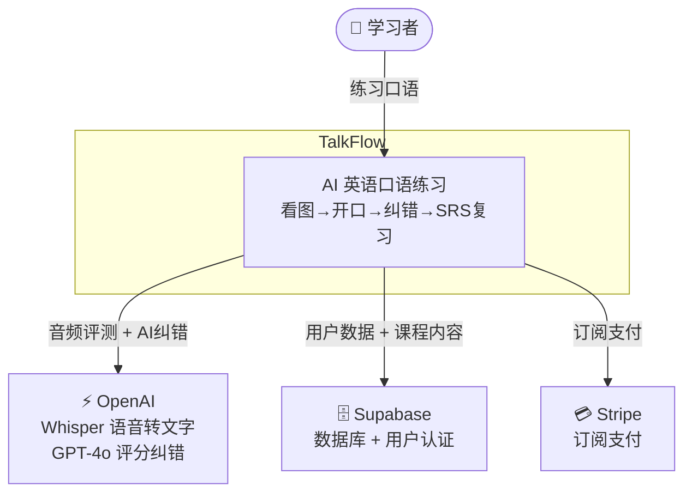
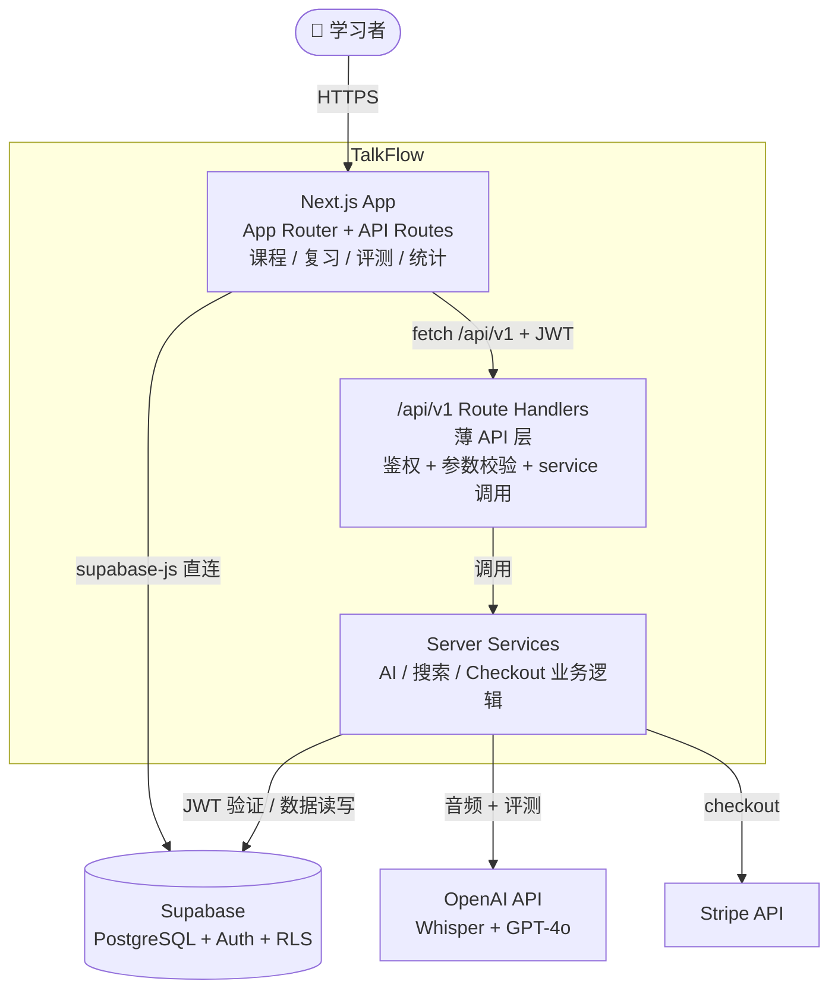
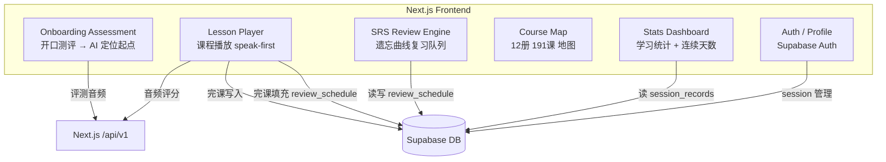
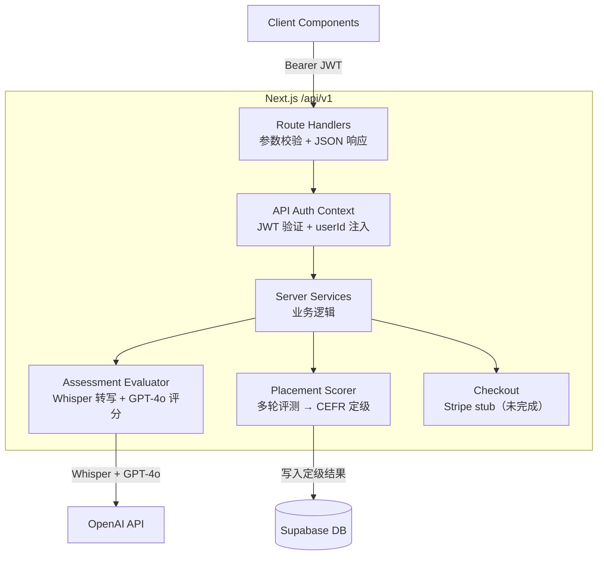
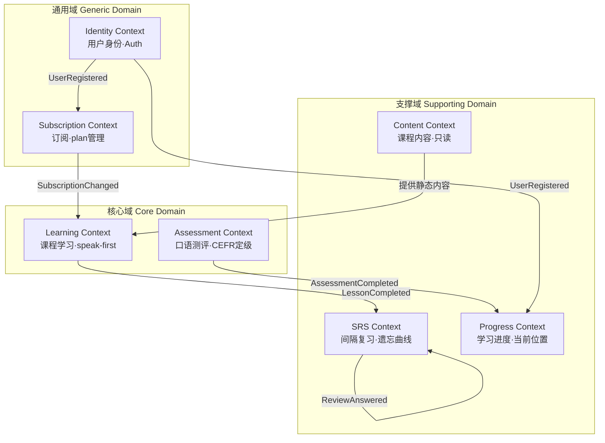
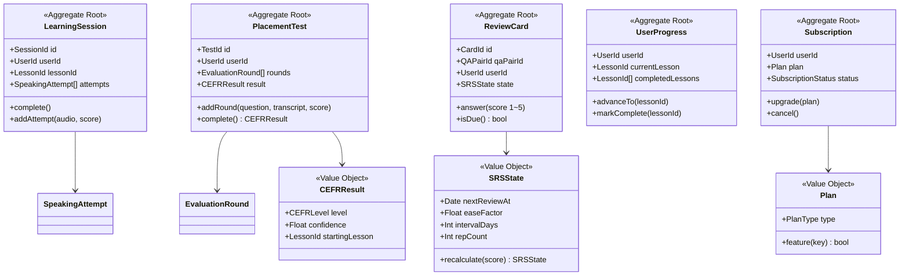
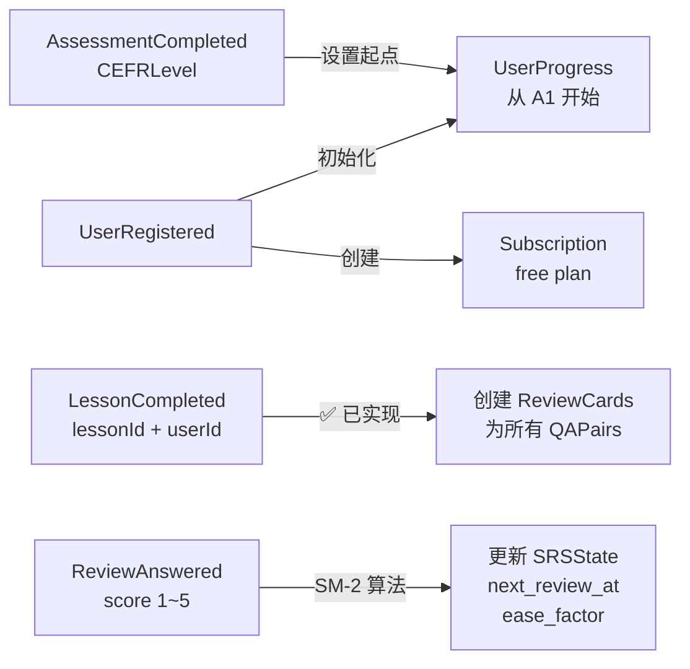

# TalkFlow

**可感知的口语提升 App**

只做一件事：**看图开口**。AI 即时纠错，15 分钟就有感觉。

---

## 产品定位

| | |
|--|--|
| **是什么** | 看图说话 + AI 即时纠错的英语口语练习工具 |
| **为谁做** | 任何想开口说几句英语、想看到真实效果的人 |
| **核心承诺** | 开口即有反馈（短期可感知）+ 学了不会忘（长期可感知）|
| **不做什么** | 语法填空、听力训练、阅读理解——一概不做 |

---

## 可感知 = 两个信号

| 信号 | 用户感受 | 机制 |
|------|---------|------|
| **短期** | 开口就知道对不对，15分钟有感觉 | AI 即时纠错（Whisper 转写 + GPT-4o 评分）|
| **长期** | 复习时记得住，进步看得见 | SRS 遗忘曲线复习队列 |

---

## 核心循环

看图 → 开口说 → AI 即时纠错 → SRS 复习

---

## 业务域优先级

**主业务域（唯一）**

```
口语练习循环
看图 → 开口说 → AI纠错 → 学完
产品存在的唯一理由
```

**从业务域**

| 优先级 | 域 | 职责 | 现状 |
|--------|-----|------|------|
| P1 | SRS 复习 | 遗忘曲线复习队列，学了不忘 | ✅ 完课写入 `review_schedule`（qa_pair 卡）；⚠️ terms 暂未入队 |
| P2 | 口语测评/定级 | Onboarding，CEFR 定起点 | ✅ 可用 |
| P3 | 学习进度 | 当前位置 + 完课记录 | ✅ 基本可用 |
| P4 | 订阅/支付 | 会员计划 + Stripe | ❌ Stub 未实现 |
| P5 | 身份认证 | Supabase Auth | ✅ 正常 |
| P5 | 课程内容 | 12册191课静态数据 | ✅ 已 seed，只读 |

---

## C4 L1 — 系统上下文



---

## C4 L2 — 容器



---

## C4 L3 — 组件：Frontend



---

## C4 L3 — 组件：API / Server



---

## DDD — 限界上下文地图



> ✅ `LessonCompleted → SRS` 已实现：`completeLesson()` 将该课全部 `qa_pairs` upsert 进 `review_schedule`（SM-2 初值 interval=1 / ease=2.5）。⚠️ `terms` 类型卡片尚未入队。

---

## DDD — 聚合根 & 实体 & 值对象



---

## DDD — 领域事件流



---

## 本地运行

```bash
cp .env.example .env.local   # 填入 Supabase / OpenAI key
npm install
npm run dev                   # Next.js 页面 + /api/v1
```

## 文档

- `CLAUDE.md` — AI Agent 架构说明和开发约定
