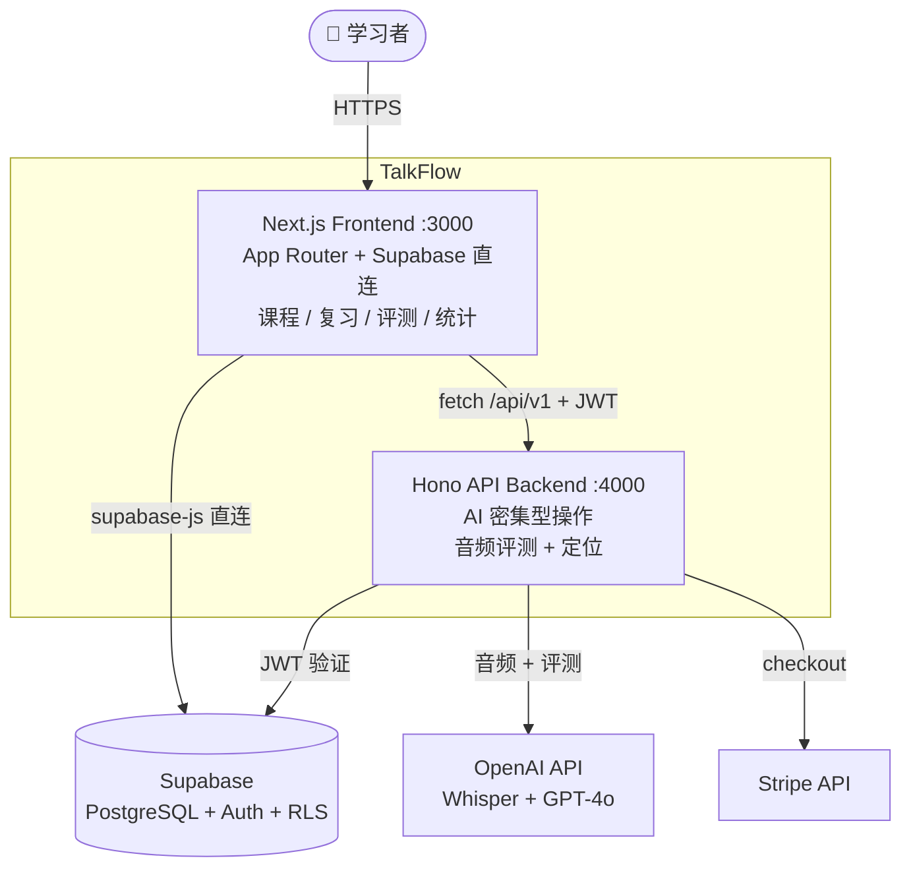
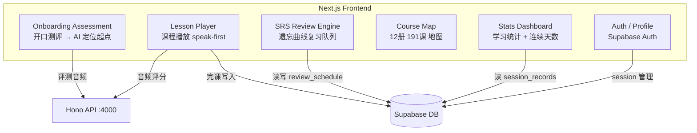
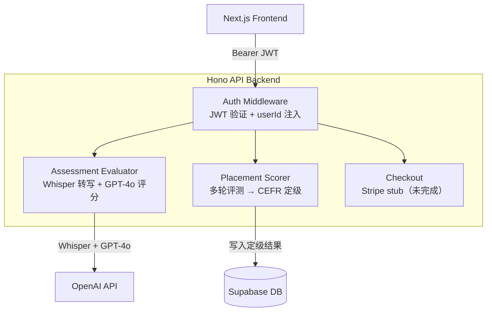

# TalkFlow

AI 驱动的英语口语练习。核心循环：**看图 → 开口说 → AI 实时纠错 → SRS 复习**

---

## C4 L1 — 系统上下文


---

## C4 L2 — 容器



---

## C4 L3 — 组件：Frontend



---

## C4 L3 — 组件：Backend



---

## 本地运行

```bash
cp .env.example .env.local   # 填入 Supabase / OpenAI key
npm install
cd backend && npm install && cd ..
npm run dev:all               # 前端 :3000 + 后端 :4000
```

## 文档

- `CLAUDE.md` — AI Agent 架构说明和开发约定
